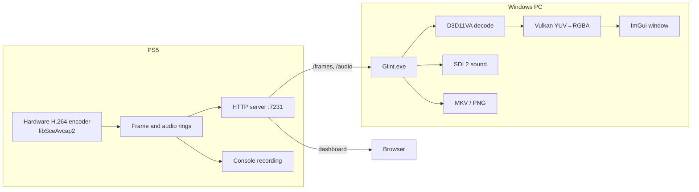

<div align="center">


**Watch, hear and record a jailbroken PS5 on your Windows PC, with low latency.**


-003791)

[](LICENSE)

[Features](#features) ·
[Quick start](#quick-start) ·
[Building](#building) ·
[Usage](#usage) ·
[How it works](#how-it-works) ·
[Docs](#documentation)

</div>

---

A small payload on the console drives the PS5's own H.264 encoder and serves
the picture and sound over a simple HTTP API. The Windows app connects to it,
decodes on the GPU and shows the console in a window, at 1080p60, with sound.
No capture card needed. A browser can also open the payload directly.

> [!IMPORTANT]
> Glint has only been tested on **firmware 13.60**, so that's where it runs
> most stable for now. Other firmwares may freeze or misbehave. It's still
> early and being tested, so expect some rough edges. If something breaks,
> please [open an issue](https://github.com/MiladRTX/Glint/issues) with your
> firmware and the logs.

<p align="center">
  
</p>

## Features

**Desktop app**

- **Live view at 1080p60** with hardware decode (D3D11VA) and GPU colour
  conversion (Vulkan). About 19 % of one CPU core for the whole app.
- **Three latency modes.** *Lowest* shows each frame the moment it arrives.
  *Balanced* absorbs Wi-Fi jitter with a small adaptive hold (~15–30 ms).
  *Smooth* uses a bigger buffer and syncs to the sound.
- **Sound** with volume and an automatic delay that adapts to the network.
- **Recording** to MKV (H.264 copy + AAC, nothing re-encoded) and PNG
  **screenshots**.
- **Gallery** with thumbnails, export to MP4/MKV and delete.
- **Picture enhancement** (Settings → Picture): upscaling with Bilinear,
  Lanczos, AMD FSR 1 or an AI network (FSRCNNX), contrast-adaptive
  sharpening, denoise, debanding and colour. Profiles, your own saved
  presets, and a frame-time guard that steps down on a weak GPU.
- **Side-by-side compare** (C): the original and the enhanced picture next to
  each other, zoomed and panned together, with a tweak panel (X).
- **Built-in viewer.** Recordings play with sound, seek and volume.
  Screenshots zoom and pan.
- **Dark and light theme** (dark by default), animated UI, auto-hiding
  controls and full screen.
- **One self-contained `Glint.exe`.** FFmpeg, curl and the runtime are
  linked in statically, so no DLLs sit next to it and no console window opens.

**Payload (PS5)**

- Drives the console's hardware encoder through `libSceAvcap2`.
- HTTP API on port **7231**: video frames, audio, status, recording on the
  console, keyframe and stop. See [API.md](docs/API.md).
- **Browser dashboard** at `http://<ps5-ip>:7231/`: live view, sound,
  screenshots, console recordings, dark and light theme. Nothing to install.
- **One viewer at a time:** the newest browser or app takes the stream; the
  others see "watching somewhere else" and can take it back.
- On-screen notifications on the console when it loads, is ready, or hits a
  problem.

## Requirements

| | |
|---|---|
| **Console** | Jailbroken PS5 with [Payload Manager](#2-run-the-payload) and an FTP server (tested on firmware 13.60) |
| **PC** | Windows 10 or 11, 64-bit, with a Vulkan-capable graphics driver |
| **Network** | PC and PS5 on the same network. Wired is best; Wi-Fi works, with more jitter. |

## Quick start

### 1. Get the files

Download both from the [latest release](https://github.com/MiladRTX/Glint/releases/latest),
or build them yourself ([Building](#building)):

- `Glint.exe`, the Windows app (one file, nothing to install)
- `Glint-1.1-ps5.elf`, the PS5 payload

### 2. Run the payload

Upload the ELF to Payload Manager's folder on the console (FTP on port 2121
here; use your console's IP):

```bash
curl --ftp-create-dirs -T Glint-1.1-ps5.elf ftp://<ps5-ip>:2121/data/pldmgr/payloads/local/glint/Glint-1.1-ps5.elf
```

A self-built ELF is `payload/build/glint-payload.elf`; upload it under the same
name.

Then start **Glint** from Payload Manager on the console. You will see
*"Glint 1.1 loaded. Starting capture..."*, then *"Glint ready on
port 7231"*.

> [!TIP]
> Payload Manager expects names shaped like `Name-version-ps5.elf`. If the
> console says *"the PS5 refused to start video capture"*, just run it again.
> This often happens on the first try after the PS5 starts.

### 3. Connect

Open `Glint.exe`, type `http://<ps5-ip>:7231` and press **Connect**. The
console's address is saved, so next time it appears under recent consoles.

Or open `http://<ps5-ip>:7231/` in any browser on the network.

## Building

The two halves build separately and talk over the network. Clone with the
Dear ImGui submodule:

```bash
git clone --recursive https://github.com/MiladRTX/Glint.git
# already cloned without it: git submodule update --init
```

### Windows app

Install [MSYS2](https://www.msys2.org/), open an **MSYS2 MinGW 64-bit** shell,
and install the toolchain:

```bash
pacman -S --needed base-devel mingw-w64-x86_64-gcc mingw-w64-x86_64-pkgconf mingw-w64-x86_64-cmake mingw-w64-x86_64-ninja mingw-w64-x86_64-nasm mingw-w64-x86_64-amf-headers mingw-w64-x86_64-x264 mingw-w64-x86_64-zlib mingw-w64-x86_64-glfw mingw-w64-x86_64-vulkan-loader mingw-w64-x86_64-SDL2
```

Then build:

```bash
cd app
./build_deps.sh    # once: static FFmpeg + curl into app/deps/prefix (a few minutes)
./build.sh         # app/build/Glint.exe
```

`build_deps.sh` downloads pinned FFmpeg and curl sources, checks their
SHA-256, and builds them with only what Glint uses. Run it again after
deleting `app/deps` to rebuild them. `mingw-w64-x86_64-shaderc` is optional:
with it, the build also recompiles the YUV→RGBA shader.

### PS5 payload

Install the [PS5 payload SDK](https://github.com/ps5-payload-dev/sdk) (Linux
or WSL), then:

```bash
cd payload/ps5
PS5_PAYLOAD_SDK=/path/to/ps5-payload-sdk make
```

This builds `payload/build/glint-payload.elf`, plus `glint-payload-test.elf`
(a synthetic picture, for testing the server on a console).

If you change `payload/assets/dashboard.html` or the banner, re-embed them
first:

```bash
node tools/gen_blobs.js
```

### Test without a console

The payload also builds on the PC with a synthetic picture, so you can run the
whole HTTP API locally:

```bash
cd payload
make                               # payload/build/glint-payload
node ../tests/run_smoke.js 19099   # starts the host build and checks the protocol
```

On MSYS2, use `make OS=Windows_NT`. Full details, including every
dependency: [docs/BUILD.md](docs/BUILD.md).

## Usage

### Keyboard shortcuts

| Key | Action | | Key | Action |
|---|---|---|---|---|
| `M` | Sound on/off | | `L` | Cycle latency mode |
| `S` | Screenshot | | `H` | Hide controls |
| `R` | Start/stop recording | | `T` | Dark / light theme |
| `G` | Gallery | | `F11` | Full screen |
| `P` | Picture size (fit / fill / no upscaling) | | `Ctrl+,` | Settings |
| `C` | Side-by-side compare | | `X` | Tweak panel (in compare) |

In the viewer: `Space` play/pause, `←` `→` seek 5 s (or previous/next
picture), `↑` `↓` volume, `Page Up` / `Page Down` previous/next item, `Esc`
close.

### Command line

```bash
Glint.exe --url http://<ps5-ip>:7231              # connect at start
Glint.exe --url http://<ps5-ip>:7231 --fullscreen
Glint.exe --theme light                           # dark (default) | light
Glint.exe --gallery                               # open the gallery
Glint.exe --view clip.mkv                         # open a file in the viewer
Glint.exe --url http://<ps5-ip>:7231 --headless 60  # decode 60 frames, exit 0/1
Glint.exe --url http://<ps5-ip>:7231 --headless 600 --latency balanced  # with latency stats
Glint.exe --version
```

Settings live in `%LOCALAPPDATA%\Glint`. Recordings and screenshots go to
`%USERPROFILE%\Videos\Glint` by default. You can change the folder in
Settings → Capture. All options: [app/README.md](app/README.md).


## How it works



1. The payload loads the console's capture library inside SceRemotePlay and
   starts the hardware encoder at 1080p60.
2. Encoded frames and AAC audio go into ring buffers. Each client streams them
   over plain HTTP. A client that falls behind skips to the newest keyframe.
3. The app decodes on the GPU, converts colour in a compute shader, and paces
   frames by the latency mode you picked.

The wire format is in [docs/API.md](docs/API.md). The capture call sequence is
in [docs/CAPTURE-INTERNALS.md](docs/CAPTURE-INTERNALS.md).

## Project layout

```
app/                  Windows app (C++17: GLFW, Vulkan, Dear ImGui, FFmpeg, SDL2, curl)
├── src/core/         payload session, HTTP client, settings, log
├── src/media/        decoder, audio, recorder, player, screenshots, gallery
├── src/shaders/      YUV → RGBA compute shader
├── res/              exe icon and version info
├── tools/            probe.cpp (headless test client), embed_fonts.js
├── build_deps.sh     static FFmpeg + curl into deps/
├── build.sh          builds Glint.exe
└── build/            Glint.exe, probe.exe (output)
payload/              PS5 payload (C11)
├── src/              HTTP server, rings, capture, injector
├── assets/           browser dashboard and banner (embedded at build time)
├── ps5/              PS5 Makefile
└── build/            glint-payload.elf and the host build (output)
tests/                mock payload, protocol smoke test, probe runner
tools/                gen_blobs.js (embeds the web assets), make_brand.py (icons and logos)
docs/                 build, API, console and internals docs; media/ holds the demo
└── brand/            logo and icons; source/ holds the original designs
```

## Documentation

| Document | What's in it |
|---|---|
| [docs/BUILD.md](docs/BUILD.md) | Toolchains, dependencies, every build step |
| [docs/CONSOLE.md](docs/CONSOLE.md) | Upload, load, check and stop the payload on the console |
| [docs/API.md](docs/API.md) | Payload HTTP API and wire formats |
| [docs/CAPTURE-INTERNALS.md](docs/CAPTURE-INTERNALS.md) | `libSceAvcap2` call sequence and error codes |
| [docs/STATUS.md](docs/STATUS.md) | What works, how it was tested, what's left |
| [app/README.md](app/README.md) | App options, settings and test modes |
| [CHANGELOG.md](CHANGELOG.md) | Release notes |

## Troubleshooting

| Problem | Try |
|---|---|
| App can't connect | Check that the payload is running (its notification shows on the console) and that the address uses port `7231`. |
| "The PS5 refused to start video capture" | The encoder needs a minute between sessions. Wait, then run the payload again. |
| Picture stutters on Wi-Fi | Switch latency to **Balanced** (`L`), or use a cable. |
| Smeared or frozen picture | Settings → Console → **Request keyframe**. |
| Upload looks fine but the payload won't start | Download the ELF back over FTP and compare its SHA-256. An interrupted upload leaves a truncated file. |

## Acknowledgements

Built with [Dear ImGui](https://github.com/ocornut/imgui),
[FFmpeg](https://ffmpeg.org/), [curl](https://curl.se/),
[SDL2](https://www.libsdl.org/), [GLFW](https://www.glfw.org/),
[x264](https://www.videolan.org/developers/x264.html), the
[Geist](https://vercel.com/font) typeface (SIL OFL), the
[PS5 payload SDK](https://github.com/ps5-payload-dev/sdk),
[AMD FidelityFX FSR 1](https://github.com/GPUOpen-Effects/FidelityFX-FSR) (MIT) and
[FSRCNNX](https://github.com/igv/FSRCNN-TensorFlow) (LGPL-3.0) for the upscalers.

## License

Glint is licensed under the [GNU General Public License v3.0](LICENSE).
Third-party parts keep their own licenses: Dear ImGui (MIT), Geist (SIL OFL
1.1, `app/vendor/fonts/OFL.txt`), FFmpeg built with x264 (GPL), curl, SDL2 and
GLFW (permissive).

## Disclaimer

Glint is a homebrew project for consoles you own. It is not affiliated
with or endorsed by Sony Interactive Entertainment. "PlayStation" and "PS5"
are trademarks of Sony Interactive Entertainment Inc.

## Credits

The PS5 capture approach in Glint was learned by studying [PBS Studio](https://github.com/seregonwar) by seregonwar.
